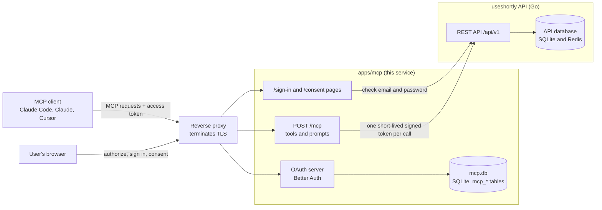
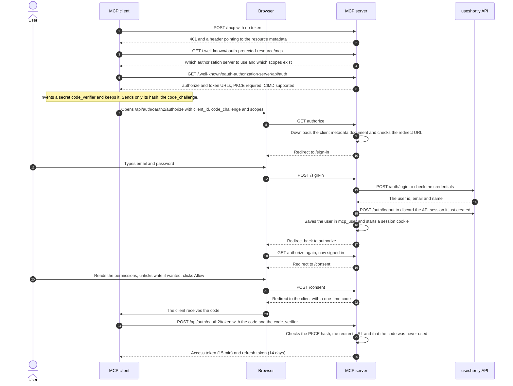
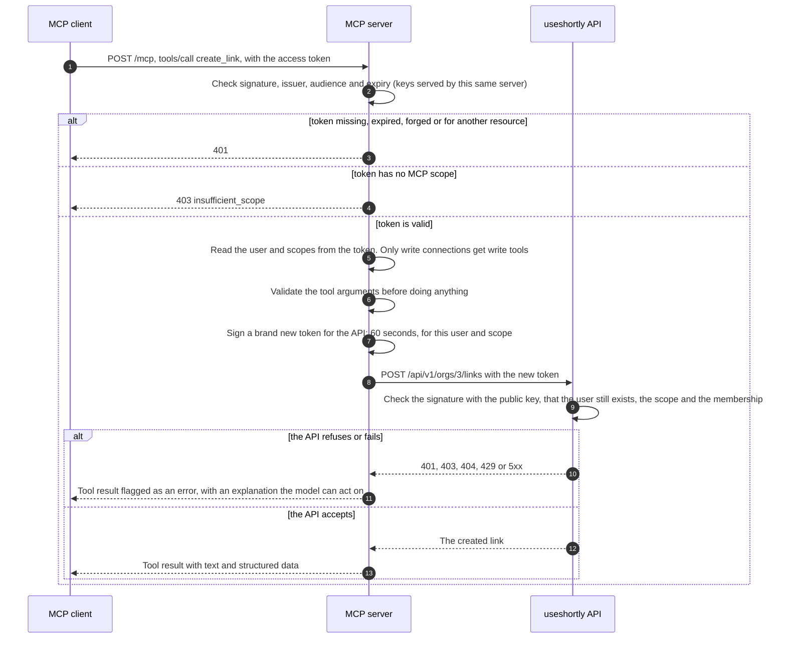
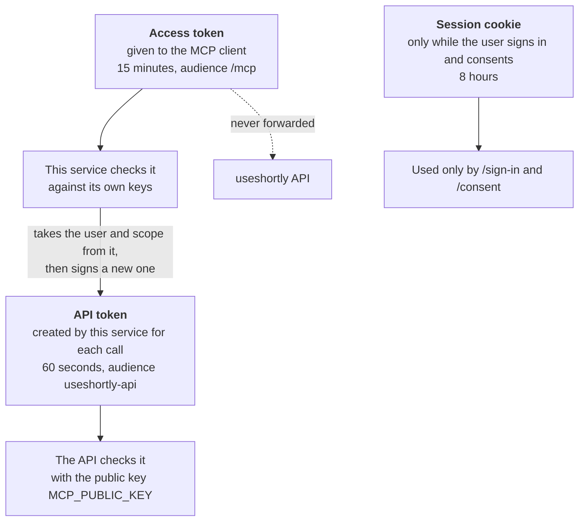
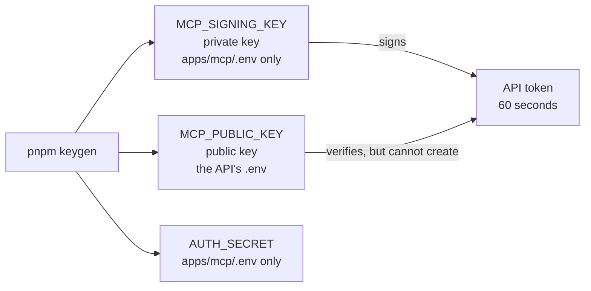

# useshortly MCP server

Lets AI assistants (Claude Code, Claude, Cursor, MCP Inspector…) work with your useshortly account: list
organizations and links, create and delete links, read click statistics, fetch QR codes and manage custom
domains. Users connect with OAuth 2.1; nobody pastes an API key.

It is a separate service next to the Go API. It does not touch the API's database and never forwards the
token a client sends it: every call to the API is signed anew for the user behind that token.

- [How it works](#how-it-works)
- [What it exposes](#what-it-exposes)
- [Run it in development](#run-it-in-development)
- [Run it in production](#run-it-in-production)
- [Connect a client](#connect-a-client)
- [Configuration reference](#configuration-reference)
- [Security model](#security-model)
- [Known limits](#known-limits)
- [Troubleshooting](#troubleshooting)
- [Working on the code](#working-on-the-code)

## How it works

### Words you will meet

| Word                          | In one sentence                                                                                                                                                                                           |
| ----------------------------- | --------------------------------------------------------------------------------------------------------------------------------------------------------------------------------------------------------- |
| **MCP**                       | A protocol that lets an AI assistant call _tools_ (functions) on a server. This service is an MCP server.                                                                                                 |
| **OAuth 2.1**                 | The standard way to let an app act for a user without giving it the user's password.                                                                                                                      |
| **Authorization code + PKCE** | The OAuth flow used here: the client gets a one-time _code_ in the browser and swaps it for tokens, proving with a secret it invented (PKCE) that it is the same client that started the flow.            |
| **Access token**              | What the client sends with every MCP request. Short-lived (15 minutes).                                                                                                                                   |
| **Refresh token**             | Lets the client get a new access token without asking the user again. Lasts 14 days.                                                                                                                      |
| **Scope**                     | A permission. Here `mcp:read` and `mcp:write`. The user decides which to grant.                                                                                                                           |
| **CIMD**                      | _Client ID Metadata Document_: the client's `client_id` is a URL, and that URL serves a small JSON file describing the client (its name and redirect URLs). It replaces registering every client by hand. |
| **JWT / JWKS**                | A signed token, and the public keys used to check its signature.                                                                                                                                          |
| **Resource / audience**       | Which server a token is meant for. A token for another resource is refused here.                                                                                                                          |

### The pieces



Two databases, on purpose: the API keeps its users, links and clicks; this service keeps only OAuth
state (clients, consents, sessions, signing keys) and one row per user that points at the API's user id.

### Connecting a client, step by step

This happens once per client, the first time the user connects it.



The password is typed on this service's page but checked by the API: it is never stored here. When the
access token expires, the client uses the refresh token and none of the browser steps repeat.

### What happens on every tool call



### Which token is which

There are three credentials. Mixing them up is the easiest way to misunderstand the design.



The keys behind this, and where each one lives:



Because the API holds only the public key, even a stolen API `.env` cannot be used to impersonate users.

## What it exposes

|                                                                          |                                                                               |
| ------------------------------------------------------------------------ | ----------------------------------------------------------------------------- |
| `POST /mcp`                                                              | The MCP endpoint (protocol 2026-07-28, stateless). GET and DELETE answer 405. |
| `/.well-known/oauth-protected-resource`                                  | Resource metadata (RFC 9728), the first thing a client reads after a 401.     |
| `/.well-known/oauth-authorization-server/api/auth`                       | Authorization server metadata (RFC 8414).                                     |
| `/api/auth/oauth2/authorize`, `/api/auth/oauth2/token`, `/api/auth/jwks` | OAuth endpoints and signing keys.                                             |
| `/sign-in`, `/consent`                                                   | The pages users see while authorizing a client.                               |
| `/health`                                                                | Liveness.                                                                     |

### Tools

Read-only connections get the first group; connections where the user granted write access also get the second.

| Tool                      | What it does                                                                |
| ------------------------- | --------------------------------------------------------------------------- |
| `whoami`                  | The account the connection acts for and whether it is read-only.            |
| `list_organizations`      | Organizations of the user, with their ids (call this first).                |
| `list_links`              | Links of an organization, paged; filterable by campaign or channel.         |
| `get_link`                | One link, with its campaign and channel.                                    |
| `get_link_stats`          | Clicks per day/hour/weekday in a time zone (`tz`), top referrers, countries, devices; filterable. |
| `get_link_qr`             | The QR code of a link as a PNG image.                                       |
| `list_campaigns`          | Campaigns of an organization, with how many channels and links each has.    |
| `get_campaign`            | One campaign.                                                               |
| `list_campaign_channels`  | The channels of a campaign (Instagram, email…).                             |
| `get_campaign_stats`      | Clicks of a whole campaign and of each channel; filterable.                 |
| `list_domains`            | Custom domains and, for unverified ones, the DNS record to create.          |
| `create_link`             | Shorten a URL (alias, expiration, click limit, password, domain, channel).  |
| `delete_link`             | Delete a link (marked destructive, so clients ask first).                   |
| `create_campaign`         | Create a campaign.                                                          |
| `update_campaign`         | Change a campaign's name or description.                                    |
| `delete_campaign`         | Delete a campaign and its channels; its links stay (marked destructive).    |
| `add_campaign_channel`    | Add a channel to a campaign.                                                |
| `delete_campaign_channel` | Delete a channel; its links stay (marked destructive).                      |
| `set_link_channel`        | Put a link in a channel, move it, or take it out of its campaign.           |
| `add_domain`              | Register a custom domain and get its DNS TXT record.                        |
| `verify_domain`           | Check the DNS record and verify the domain.                                 |

A link put in a campaign channel gets `utm_source` (the channel), `utm_medium=useshortly` and `utm_campaign` (the
campaign) added to its destination, which with them must fit in 255 characters. Moving it rewrites those parameters;
taking it out of its campaign removes them. Deleting a campaign or a channel never deletes its links.

Prompts: `link_performance_report` and `campaign_performance_report` (everyone) and `shorten_url` (write connections).

Not exposed on purpose: creating or deleting organizations or accounts, members and invitations, API keys,
unlock pages and deleting domains.

## Run it in development

Everything runs on your machine over plain `http://localhost`, which OAuth clients accept for local work.
Follow the steps in order: each one needs the one before.

### 0. Install what you need once

| Tool          | Version                                 | Why                                                                  |
| ------------- | --------------------------------------- | -------------------------------------------------------------------- |
| Go            | 1.26 or newer                           | the API                                                              |
| Node.js       | 24                                      | this service                                                         |
| pnpm          | 12.15.0 (`npm install -g pnpm@12.15.0`) | this service's package manager, pinned in `package.json`             |
| Redis         | any recent                              | the API refuses to start without it (OTP codes, caches, rate limits) |
| `sqlite3` CLI | any                                     | applies the API's SQL migrations                                     |

A quick Redis: `docker run -d --name redis -p 6379:6379 redis:7` (or `brew install redis && redis-server`).

### 1. Create the keys

```sh
cd apps/mcp
pnpm install
pnpm keygen
```

It prints three lines. Keep the terminal open, you will paste them in steps 2 and 3:

```
MCP_SIGNING_KEY=...     → apps/mcp/.env
AUTH_SECRET=...         → apps/mcp/.env
MCP_PUBLIC_KEY=...      → the API's .env (repository root)
```

### 2. Set up and start the API

From the repository root:

```sh
cp .env.example .env
```

Edit `.env` and set at least:

```sh
REDIS_URL=redis://localhost:6379
JWT_SECRET=<32 or more random characters, e.g. the output of: openssl rand -base64 32>
OTP_SECRET=<another 32 or more random characters>
MCP_PUBLIC_KEY=<the MCP_PUBLIC_KEY line from step 1>
```

Leave `RESEND_API_KEY` empty: in development the API prints the emails (including sign-up codes) in its log.
Then create the database and run the API:

```sh
make migrate-up     # needs the sqlite3 CLI; applies migrations/*.up.sql to DATABASE_PATH
make run            # API on http://localhost:8080
```

Leave it running. If you add or change `MCP_PUBLIC_KEY` later, restart the API.

### 3. Set up and start the MCP server

In a second terminal:

```sh
cd apps/mcp
cp .env.example .env
```

Edit `apps/mcp/.env`: paste `MCP_SIGNING_KEY` and `AUTH_SECRET` from step 1. The defaults for the rest already
fit development (`MCP_PUBLIC_URL=http://localhost:4001`, `API_URL=http://localhost:8080`). Then:

```sh
pnpm dev            # http://localhost:4001, restarts when you edit the code
```

On the first start it creates `data/mcp.db` and prints `migrations applied: created [mcp_user, …]`.

### 4. Create a test account and an organization

The MCP server signs users in against the API, so you need a user with an organization.

```sh
# 1. Register. The API answers 202 and prints a 6-digit code in ITS log (the terminal from step 2).
curl -s -X POST localhost:8080/api/v1/auth/register -H 'content-type: application/json' \
  -d '{"email":"you@example.com","password":"a-long-password","first_name":"Ada","last_name":"Lovelace"}'

# 2. Confirm with that code. The answer contains data.token.
curl -s -X POST localhost:8080/api/v1/auth/register/verify -H 'content-type: application/json' \
  -d '{"email":"you@example.com","code":"123456"}'

# 3. Create an organization (paste the token from the previous answer).
curl -s -X POST localhost:8080/api/v1/orgs -H 'content-type: application/json' \
  -H 'authorization: Bearer <data.token>' -d '{"name":"My team"}'
```

### 5. Check that everything is up

```sh
curl -s localhost:4001/health                                     # {"status":"ok"}
curl -si -X POST localhost:4001/mcp | head -3                     # 401 with a WWW-Authenticate header
curl -s localhost:4001/.well-known/oauth-protected-resource/mcp   # JSON with "resource" and "authorization_servers"
```

### 6. Connect a client

Use `http://localhost:4001/mcp` as the URL: see [Connect a client](#connect-a-client). Sign in with the
account from step 4.

Useful while developing: `pnpm test` (unit and end-to-end tests, no API or internet needed), `pnpm typecheck`,
and `docker compose -f docker-compose.dev.yml --profile mcp up` if you prefer containers with hot reload
(it needs `apps/mcp/.env` from step 3, and the API's `REDIS_URL` must be reachable from inside Docker, so
`localhost` will not do).

## Run it in production

You need: a server with Docker, **two things the repository does not provide** (a Redis the API can reach and
a reverse proxy with TLS), a DNS name for this service, and an email provider (the API refuses to start in
production without `RESEND_API_KEY` and `MAIL_FROM`). Follow the steps in order.

### 1. Pick the names and put TLS in front

Choose the public address of this service, for example `https://mcp.example.com`. OAuth clients refuse plain
`http` outside localhost, so TLS is not optional. The API keeps its own address; the MCP server reaches it over
the Docker network, so the API does not need to be public for this feature.

### 2. Create the keys

On any machine with Node 24 and pnpm 12.15.0:

```sh
cd apps/mcp && pnpm install && pnpm keygen
```

(Without Node: `openssl genpkey -algorithm ED25519 -out mcp-private.pem`, use `base64 < mcp-private.pem | tr -d '\n'`
as `MCP_SIGNING_KEY`, and the output of `openssl pkey -in mcp-private.pem -pubout` as `MCP_PUBLIC_KEY`.)

Store the private key and `AUTH_SECRET` in your secret manager. The public key is not secret.

### 3. Configure the API

In the API's `.env` (repository root), besides what you already run in production (`REDIS_URL`, `JWT_SECRET`,
`OTP_SECRET`, `RESEND_API_KEY`, `MAIL_FROM`, `APP_URL`):

```sh
MCP_PUBLIC_KEY=<the public key from step 2>
```

### 4. Prepare the API's database

The API's migrations are plain SQL applied with the `sqlite3` CLI (`make migrate-up`); this repository does not
run them for you inside Docker. Apply them to the database file the API uses (the `data` volume, file
`/data/useshortly.db`) before the first start and after every upgrade that adds a migration. The simplest way is
to run `make migrate-up` with `DATABASE_PATH` pointing at that file, from a host or throwaway container that has
the `sqlite3` CLI and can reach the volume. The MCP server needs no manual step: it migrates its own database
every time it starts.

### 5. Configure the MCP server

Create `apps/mcp/.env`:

```sh
MCP_SIGNING_KEY=<private key from step 2>
AUTH_SECRET=<AUTH_SECRET from step 2>
MCP_PUBLIC_URL=https://mcp.example.com    # step 1, https, no trailing slash
TRUST_PROXY=true                          # you will put a reverse proxy in front
# Optional:
# GOOGLE_CLIENT_ID=<same Google client as the API>
# MCP_TURSO_DATABASE_URL=...   MCP_TURSO_AUTH_TOKEN=...
```

Do not set `API_URL`, `PORT` or `MCP_DATABASE_PATH`: `docker-compose.yml` already sets them
(`http://app:8080`, `4001`, `/data/mcp.db`). `ENVIRONMENT` is forced to `production`, which refuses a
non-https `MCP_PUBLIC_URL`.

### 6. Start the stack

```sh
docker compose --profile mcp up -d --build
docker compose logs -f mcp        # wait for: listening on :4001
```

The `mcp` profile is opt-in: without `--profile mcp` only the API starts. The database lives in the `mcp_data`
volume. The container publishes port `4001` on every interface of the host: either firewall it so only your
proxy reaches it, or bind it yourself (for example `127.0.0.1:4001:4001`).

### 7. Configure the reverse proxy

Forward **every** path of `mcp.example.com` to the service on port 4001: discovery and OAuth live under
`/.well-known/`, `/api/auth/`, `/sign-in`, `/consent` and `/mcp`. Pass `Host`, `X-Forwarded-For` and
`X-Forwarded-Proto`, and do not buffer responses (MCP can stream).

Caddy (TLS is automatic):

```
mcp.example.com {
    reverse_proxy 127.0.0.1:4001 {
        flush_interval -1
    }
}
```

nginx (inside a `server` block that already terminates TLS):

```
location / {
    proxy_pass http://127.0.0.1:4001;
    proxy_set_header Host $host;
    proxy_set_header X-Forwarded-For $proxy_add_x_forwarded_for;
    proxy_set_header X-Forwarded-Proto $scheme;
    proxy_buffering off;
}
```

### 8. Check it from the outside

```sh
curl -s https://mcp.example.com/health
curl -si -X POST https://mcp.example.com/mcp | head -5        # 401 and WWW-Authenticate: Bearer resource_metadata="https://mcp.example.com/..."
curl -s https://mcp.example.com/.well-known/oauth-authorization-server/api/auth
```

The `issuer` in the last answer must be exactly `https://mcp.example.com/api/auth`. If it says `http://` or
`localhost`, `MCP_PUBLIC_URL` is wrong.

### 9. Connect and test

Add `https://mcp.example.com/mcp` in a client (see below), sign in, allow, and ask it "who am I on useshortly?".
That exercises the whole chain: OAuth, the MCP endpoint, the signed call to the API and its answer.

### Running it afterwards

- **Backups:** copy the `mcp_data` volume (a SQLite file, `mcp.db`) together with the API's `data` volume.
- **Upgrading:** `git pull`, apply any new API migration (step 4), then `docker compose --profile mcp up -d --build`.
- **Rotating the signing key:** run `pnpm keygen` again, update `MCP_SIGNING_KEY` here and `MCP_PUBLIC_KEY` on the
  API **at the same time**, restart both. Access tokens the clients hold keep working until they expire
  (15 minutes) because they are signed by Better Auth's own keys, not by this key.
- **Revoking someone:** deleting their account in the API cuts their MCP access at once, because the API checks on
  every call that the user still exists.

## Connect a client

The URL is always `https://<your host>/mcp` (`http://localhost:4001/mcp` in development).

- **Claude Code**: `claude mcp add --transport http useshortly https://mcp.example.com/mcp`, then run
  `/mcp` inside Claude Code and choose _Authenticate_. A browser opens on your `/sign-in` page.
- **Claude and other apps with custom connectors**: add a remote MCP server with that URL.
- **MCP Inspector**: `npx @modelcontextprotocol/inspector`, transport _Streamable HTTP_, that URL.

Check each client's own documentation for the exact steps: they change faster than this file. At sign-in
the user enters their useshortly email and password (or uses Google), then sees what the client asks for
and can untick write access before allowing it.

## Configuration reference

Copy `.env.example` to `.env`. `pnpm dev` and `pnpm start` read it; in Docker, Compose reads it.

| Variable                                         | Default                 | Notes                                                                                                                                                                  |
| ------------------------------------------------ | ----------------------- | ---------------------------------------------------------------------------------------------------------------------------------------------------------------------- |
| `MCP_SIGNING_KEY`                                | –                       | Ed25519 private key (PKCS8 PEM or its base64). Required.                                                                                                               |
| `AUTH_SECRET`                                    | –                       | At least 32 characters. Required.                                                                                                                                      |
| `MCP_PUBLIC_URL`                                 | `http://localhost:4001` | Where clients reach this service. **https in production**, no trailing slash. It is the OAuth issuer and the MCP resource, so changing it invalidates existing tokens. |
| `API_URL`                                        | `http://localhost:8080` | The API, without `/api/v1`. In Docker Compose it is `http://app:8080`.                                                                                                 |
| `PORT`                                           | `4001`                  | The service also fetches its own signing keys from `127.0.0.1:PORT`, so it must be the port it really listens on.                                                      |
| `ENVIRONMENT`                                    | `development`           | `production` demands an https `MCP_PUBLIC_URL`.                                                                                                                        |
| `TRUST_PROXY`                                    | `false`                 | Set `true` behind the reverse proxy so rate limits count each visitor, not the proxy.                                                                                  |
| `MCP_DATABASE_PATH`                              | `data/mcp.db`           | This service's own SQLite file. Migrations run on every start.                                                                                                         |
| `MCP_TURSO_DATABASE_URL`, `MCP_TURSO_AUTH_TOKEN` | empty                   | Both set: also sync that file with Turso Cloud.                                                                                                                        |
| `MCP_SYNC_INTERVAL_SECONDS`                      | `30`                    | Pull/push period when syncing.                                                                                                                                         |
| `GOOGLE_CLIENT_ID`                               | empty                   | The same Google OAuth client the API uses; shows "Continue with Google".                                                                                               |
| `TRUSTED_ORIGINS`                                | empty                   | Comma separated origins allowed to call Better Auth from a browser.                                                                                                    |

On the API side the only addition is `MCP_PUBLIC_KEY` (PEM, or base64 of the raw 32 bytes). Empty means MCP
access is off.

## Security model

- **No passwords here.** `/sign-in` asks the API to check the credentials and keeps only a mapping
  `mcp_user.user_id → API user`. The session the API starts for that check is revoked right away.
- **No token passthrough.** The access token a client holds is only good for this service. For each tool
  call it signs a fresh EdDSA token (60 seconds, audience `useshortly-api`) for that user and scope. The
  API accepts those tokens for the read-only account views (who am I, my organizations) and for the
  organization routes MCP uses, never to change accounts, organizations, members or API keys. It checks on
  every request that the user still exists: deleting an account cuts MCP access at once.
- **Scopes.** `mcp:read` and `mcp:write`. Write implies read. The user can narrow a request on the
  consent screen, and write tools do not even appear on a read-only connection.
- **Short lives.** Access tokens last 15 minutes, refresh tokens 14 days, the sign-in session 8 hours.
- **Client identity.** Clients identify themselves with a Client ID Metadata Document (the way the MCP
  2026-07-28 spec pins). Dynamic client registration is off.
- **Hardening.** Pages carry a strict CSP and cannot be framed; forms accept only same-origin posts;
  failed sign-ins are rate limited per address and per account; link destinations and referrers shown to
  the model are cut to one line (the full value stays in the structured result) so they cannot pose as
  instructions.

## Known limits

- Only MCP protocol 2026-07-28 is served. Clients that speak only the 2025 versions are rejected.
- Clients that need dynamic client registration cannot connect. Turning it on is a deliberate choice that
  is not made here.
- The API limits `/auth/login` and `/auth/google` strictly per address. Every sign-in through this
  service reaches the API from the service's address, so many users signing in at the same moment can
  hit that limit (HTTP 429, shown to them as "too many attempts"). The service forwards the visitor's
  address in `X-Forwarded-For`, but the API only reads it with `TRUST_PROXY=true`, which is safe only when
  the API is reachable solely through a proxy you control.
- The API's migrations are not applied automatically inside Docker (see production step 4).
- Syncing with Turso Cloud is implemented and tested against Turso's local engine, but not yet against
  the cloud service itself. Try it on a throwaway database first.
- If you change `MCP_SIGNING_KEY`, update `MCP_PUBLIC_KEY` on the API at the same time.

## Troubleshooting

| Symptom                                                                                   | Likely cause and fix                                                                                                                                                                 |
| ----------------------------------------------------------------------------------------- | ------------------------------------------------------------------------------------------------------------------------------------------------------------------------------------ |
| The service stops at start with `Invalid configuration:`                                  | It lists each bad variable. The usual ones: `AUTH_SECRET` under 32 characters, `MCP_SIGNING_KEY` not an Ed25519 key, `MCP_PUBLIC_URL` with a trailing slash or `http` in production. |
| A client says it cannot register or authorize                                             | It probably needs dynamic client registration, which is off. Use a client that supports Client ID Metadata Documents.                                                                |
| Sign-in says "useshortly could not be reached"                                            | `API_URL` is wrong or the API is down. In Docker it must be `http://app:8080`.                                                                                                       |
| Sign-in works but every tool answers "reconnect" or a 401                                 | The API does not accept the MCP's tokens: `MCP_PUBLIC_KEY` is missing, differs from the private key, or the API was not restarted after adding it.                                   |
| `/mcp` answers 401 to a token that was just issued, and the log shows `JWKS fetch failed` | The service fetches its keys from `127.0.0.1:PORT`: `PORT` must be the port it listens on.                                                                                           |
| Clients that worked stop working after you changed the address                            | `MCP_PUBLIC_URL` is the issuer inside every token. Reconnect the clients.                                                                                                            |
| Sign-in shows "Too many attempts" for everyone                                            | The API's per-address limit (see Known limits), or someone is guessing passwords.                                                                                                    |
| The client sees no write tools                                                            | The user left write unticked on the consent screen, or the client only asked for read. Disconnect and connect again.                                                                 |

## Working on the code

```sh
pnpm install
pnpm dev          # server with hot reload
pnpm typecheck
pnpm test         # unit and end-to-end tests; the API and the internet are simulated
pnpm build        # compiled JS in dist/
```

Layout: `src/auth` (Better Auth, sign-in delegation), `src/http` (sign-in and consent pages), `src/api`
(the signed API client), `src/mcp` (route, tools, prompts), `src/db` (SQLite and Turso), `src/e2e` (the
full client journey) and `src/test` (the harness the tests share).
